# From Distance to Trust

**Analysis of User Opinions on Interactions with AI Chatbots**

An NLP-driven study of how affect toward AI chatbots differs across use-case categories, evolves over time, and relates (or fails to relate) to star ratings — based on ~140,000 Reddit posts, comments, and app store reviews.

---

## Overview

Some people talk to chatbots every day — to save time finding information, process difficult emotions, or organise their schedule. Yet how they feel about these conversations can vary enormously, depending on how someone — or something — responds on the other side.

This project explores the emotional landscape of user opinions on human–chatbot interactions across four distinct contexts: **general-purpose AI, therapeutic, educational, and virtual assistants**. Using three complementary sentiment models, statistical hypothesis testing, topic modelling, and machine learning classification, it maps the affective content of user experience — from distance and distrust to relief and genuine connection.

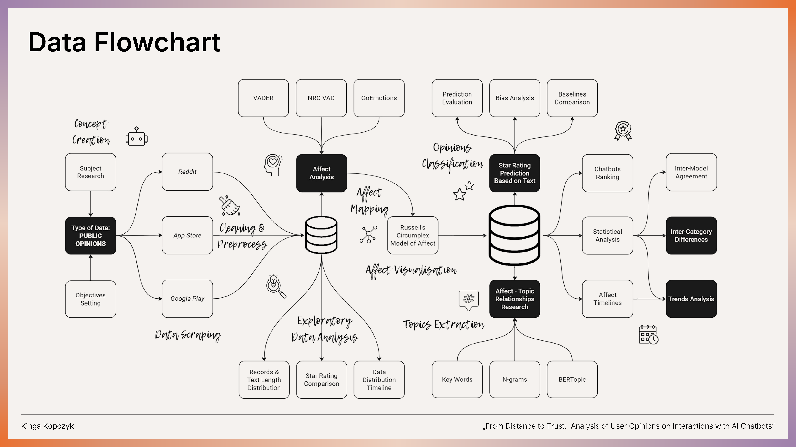

## Research Questions

1. Does affect in user opinions vary depending on the chatbot category?
2. What topic-affect patterns recur across opinions?
3. Has sentiment toward chatbots changed over time?
4. How much of a review's star rating can be predicted from sentiment scores derived from the text of the comment?

---

## Key Findings

### 1 · Affect varies by chatbot category — but part of the pooled effect reflects the source mix

Kruskal-Wallis tests on the pooled data confirm category differences in valence across all three sentiment models (p < .001), with small-to-moderate effect sizes:

| Model | H-statistic | ε² (valence) | ε² (arousal) |
|---|---|---|---|
| NRC VAD | 2767 | 0.020 | 0.002 *(negligible)* |
| VADER | 3467 | 0.025 | — |
| GoEmotions | 4838 | 0.035 | 0.011 *(small)* |

A one-way MANOVA on valence and arousal jointly confirms the separation is statistically robust (Wilks' λ = 0.979, F(6, 273942) = 491.21, p < .001). Categories differ **mainly in valence**, not arousal.

In the pooled data, Dunn's post-hoc test (Bonferroni-corrected) gives the same pair ordering in all three models:
- **Largest valence gap:** Educational ↔ General
- **Smallest valence gap:** Therapeutic ↔ Virtual Assistant

#### Robustness check: within data source

Category is partly confounded with data source (Educational is app reviews only, while about 84–86% of Therapeutic and General records come from Reddit — see [Limitations](#limitations)), so the pooled comparison may partly measure the source mix. The tests were therefore repeated within each source (notebook Section 6.4):

| Subset | n | ε² VADER | ε² NRC VAD | ε² GoEmotions |
|---|---|---|---|---|
| All records | 140,134 | 0.0247 | 0.0202 | 0.0344 |
| App reviews only (all 4 categories) | 33,473 | 0.0065 | 0.0061 | 0.0223 |
| Reddit only (3 categories, no Educational) | 106,661 | 0.0097 | 0.0042 | 0.0076 |

Differences remain statistically significant in every subset (p < .001), but with the source held constant the effect sizes fall by about 35–75%, and the ordering of category pairs stops being consistent across models: within app reviews, Educational ↔ General is the largest gap in NRC VAD and GoEmotions but the smallest in VADER, and Educational ↔ Therapeutic is not significant in NRC VAD and GoEmotions. The one pattern that holds in all three models within Reddit is that General discussions are more negative than Therapeutic and Virtual Assistant ones. The pooled category ranking above should therefore be read as partly a source effect.

*(n is smaller for NRC VAD where scores are missing; the pooled GoEmotions ε² is recomputed from the saved CSV, 0.0344 vs. 0.035 in the first table.)*

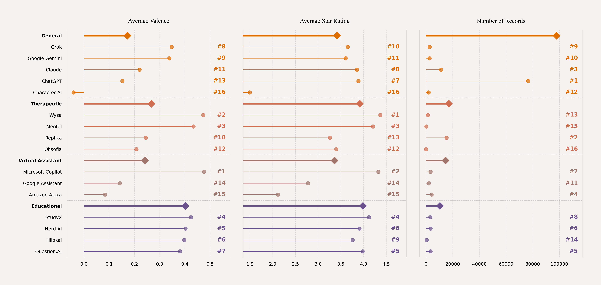
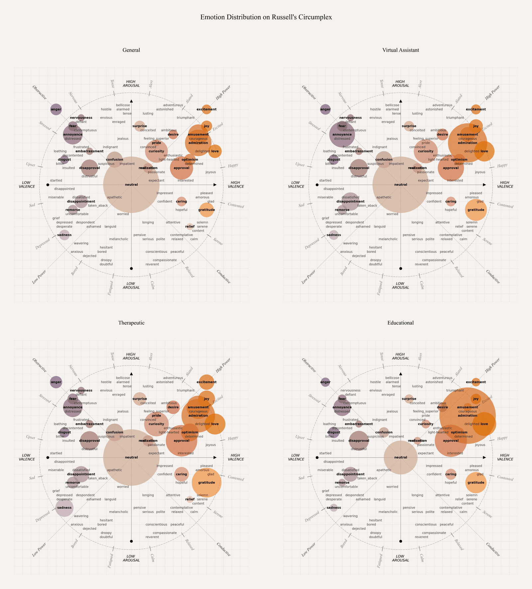
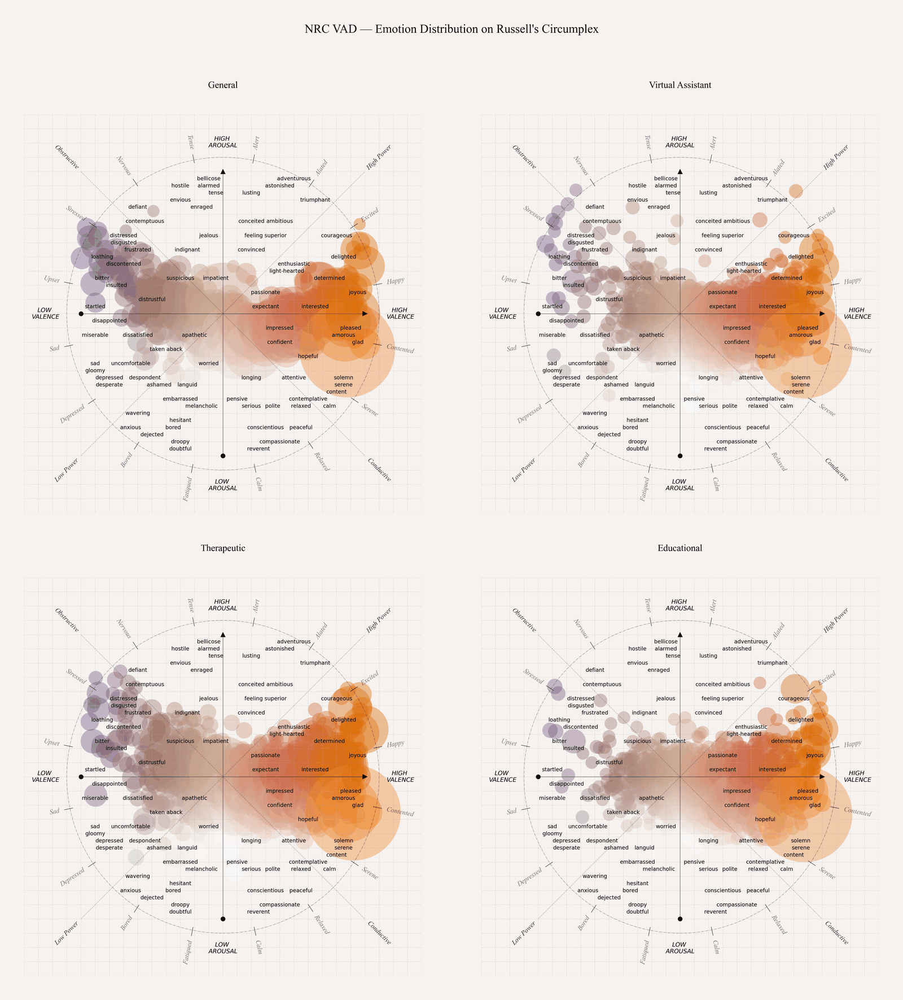
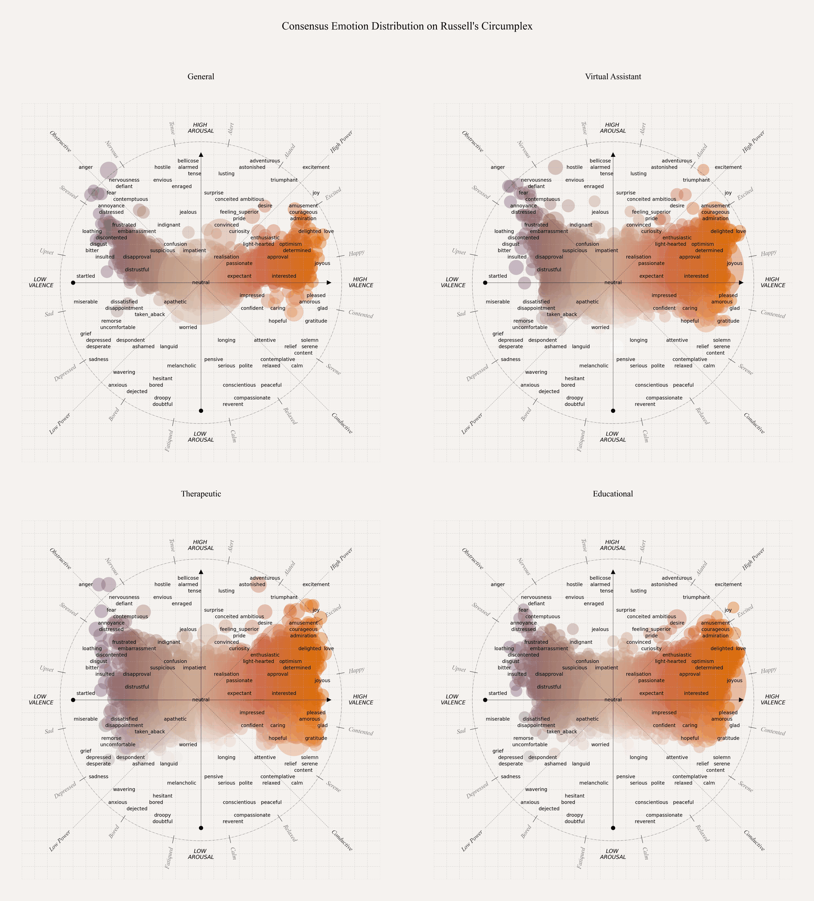

### 2 · Topic-affect patterns are category-specific

Topics, keywords and n-grams analysis reveals thematically distinct patterns per category — therapeutic users write about relationships and emotional support, educational users about correct/incorrect answers and paywalls, virtual assistant users about smart-home routines and device reliability, and general chatbot users about capabilities, safety, and censorship debates.

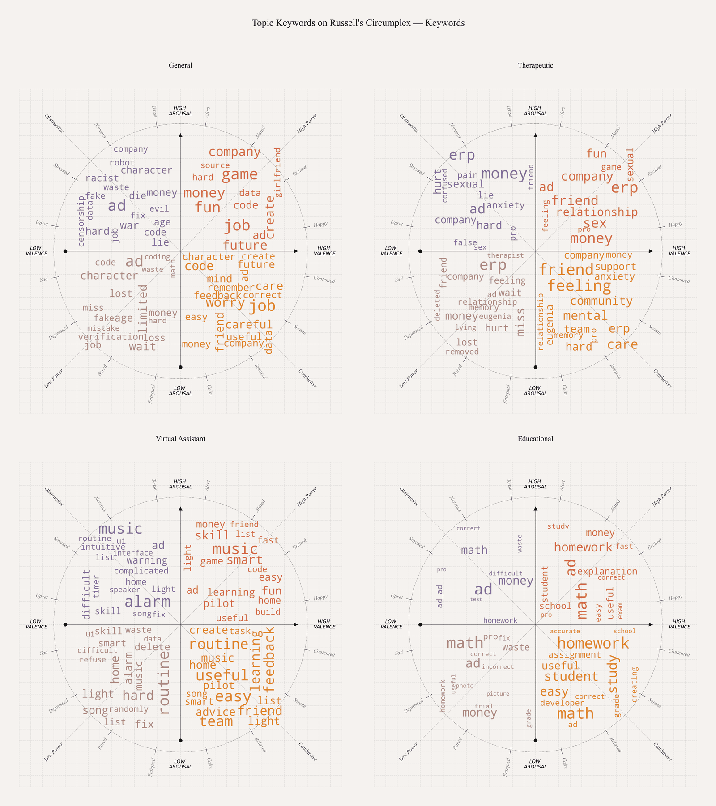
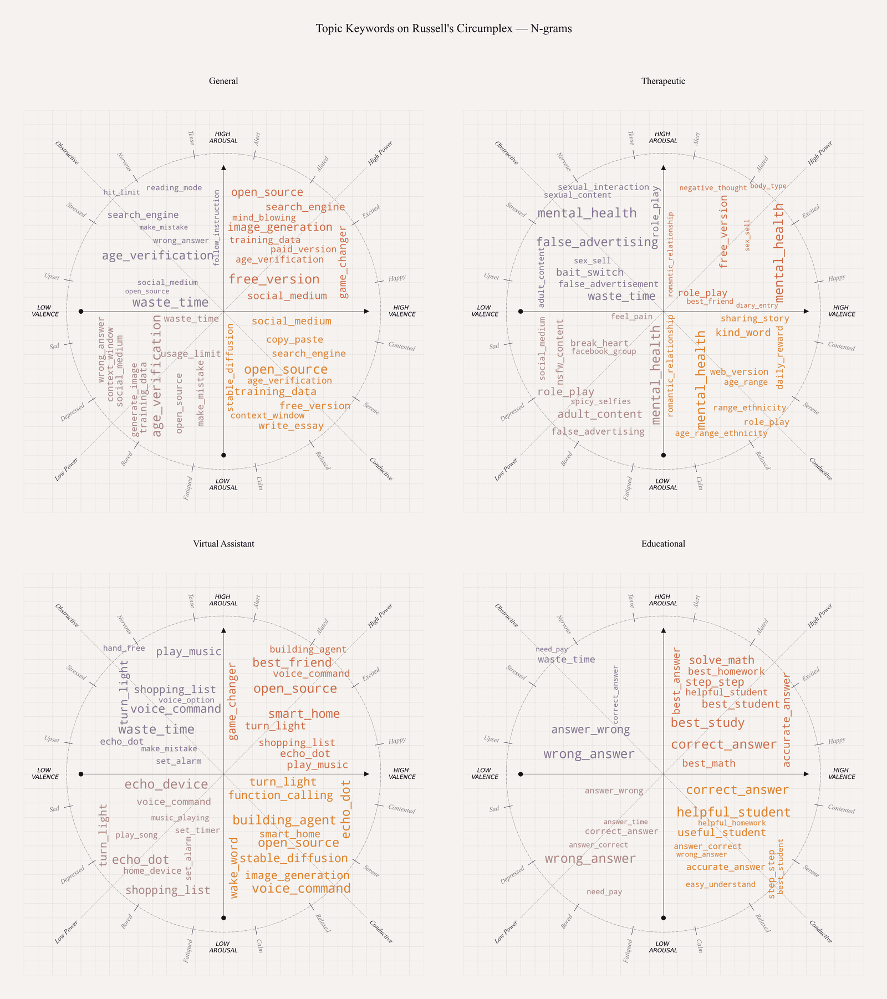
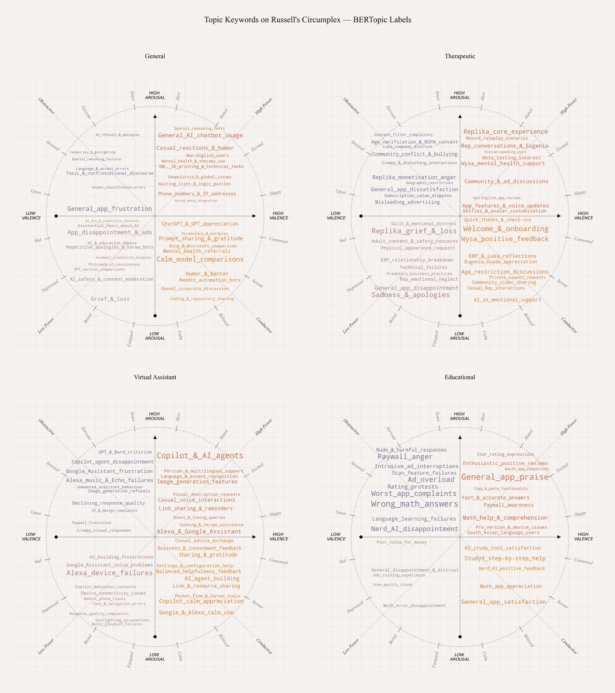

### 3 · Sentiment shifted over time — but not uniformly

Spearman correlation on monthly mean valence, by category (12 tests: 4 categories × 3 models; only results with uncorrected p < .05 are listed):

| Category | Model | ρ | p (uncorrected) | p (Holm-adjusted) | Direction |
|---|---|---|---|---|---|
| **Educational** | VADER | −0.571 | < .001 | **.001** | ↘ **downward** |
| **Educational** | GoEmotions | −0.468 | .002 | **.020** | ↘ **downward** |
| Therapeutic | NRC VAD | +0.361 | .017 | .175 | ↗ upward *(exploratory)* |
| Virtual Assistant | NRC VAD | +0.328 | .032 | .288 | ↗ upward *(exploratory)* |
| General | VADER | +0.318 | .040 | .319 | ↗ upward *(exploratory)* |
| Virtual Assistant | VADER | +0.308 | .044 | .319 | ↗ upward *(exploratory)* |

After correction for multiple comparisons only the two **Educational** declines remain significant; the upward trends in the other categories do not survive it and should be read as exploratory. The Educational decline is itself model- and app-dependent (notebook Section 7.1.5): with app fixed effects the yearly slope is negative for VADER (−0.067) and GoEmotions (−0.047) but positive for NRC VAD (+0.065), and per app, VADER and GoEmotions fall significantly only for Question.AI (ρ = −0.71 and −0.64) while StudyX rises in all three models. It is best read as an app-specific signal rather than as evidence that sentiment toward educational chatbots in general has deteriorated. Monthly means are also autocorrelated and dataset composition changes over time (see [Limitations](#limitations)).

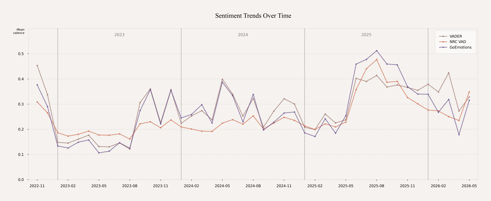
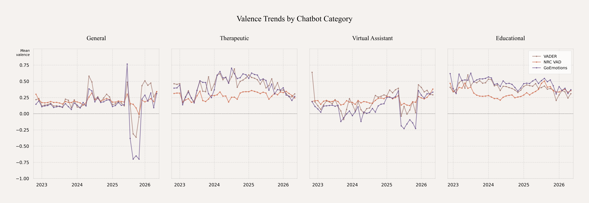

### 4 · Star ratings are only partially predictable from text

| Classifier | Accuracy | F1 Macro | AUC-ROC |
|---|---|---|---|
| Gradient Boosting | 0.71 | 0.32 | 0.78 |
| Random Forest | 0.69 | 0.34 | 0.73 |
| **Logistic Regression** | 0.55 | **0.38** | 0.76 |
| *Majority Class baseline* | *0.53* | *0.14* | *0.50* |
| *Stratified Random baseline* | *0.37* | *0.20* | *0.50* |

All three classifiers clear both baselines on every metric (for Logistic Regression the accuracy margin is thin: 0.55 vs. 0.53). The best overall configuration — **Logistic Regression on all models combined** (F1 macro = 0.384, AUC-ROC = 0.756) — is also the most balanced across classes. The strongest single result is **1★ review detection** (Random Forest on GoEmotions: recall = 0.860, F1 = 0.666), suggesting sentiment features are more useful for flagging negative reviews than for reconstructing the full 5-point scale.

**Cross-validation and a text baseline** (notebook Section 10.5; 5-fold stratified CV on the same 32,720 reviews, mean ± SD):

| Model | Accuracy | F1 Macro | AUC-ROC | 1★ recall / precision |
|---|---|---|---|---|
| Logistic Regression (sentiment scores) | 0.547 ± 0.007 | 0.379 ± 0.003 | 0.756 | 0.59 / 0.70 |
| Random Forest (sentiment scores) | 0.604 ± 0.009 | 0.360 ± 0.004 | 0.730 | 0.71 / 0.62 |
| Gradient Boosting (sentiment scores) | 0.709 ± 0.004 | 0.314 ± 0.003 | 0.780 | 0.85 / 0.62 |
| **TF-IDF + Logistic Regression (review text)** | 0.660 ± 0.008 | **0.466 ± 0.010** | 0.822 | 0.70 / 0.74 |
| *Majority Class baseline* | *0.534* | *0.139* | *0.500* | *0 / –* |
| *Stratified Random baseline* | *0.357* | *0.195* | *0.497* | *0.24 / 0.24* |

Cross-validated scores match the single split (e.g. Logistic Regression macro-F1 0.379 vs. 0.384), but a plain TF-IDF model on the review text clearly beats every sentiment-score model (macro-F1 ≈ 0.47 vs. ≤ 0.38, AUC-ROC 0.82 vs. ≤ 0.78). Sentiment scores therefore carry only part of the rating-relevant information in the text, and the modest scores above reflect the limited feature set as well as noise in star ratings. The Random Forest row differs from the single-split table (accuracy 0.60 vs. 0.69, AUC-ROC identical) while Logistic Regression and Gradient Boosting reproduce exactly; this run used scikit-learn 1.9.1 and the cause was not investigated.

**Scope of this result:** the first table uses only the five sentiment and arousal scores as features, a single stratified 80/20 split (test set ≈ 6,500 reviews) and default hyperparameters. It shows how much of the star rating these scores carry, not how well review text can predict it — see the text baseline above.

**Conclusion:** within these limits, star ratings and text-derived sentiment scores capture related but distinct signals — they should be treated as complementary, not interchangeable, measures of user opinion.

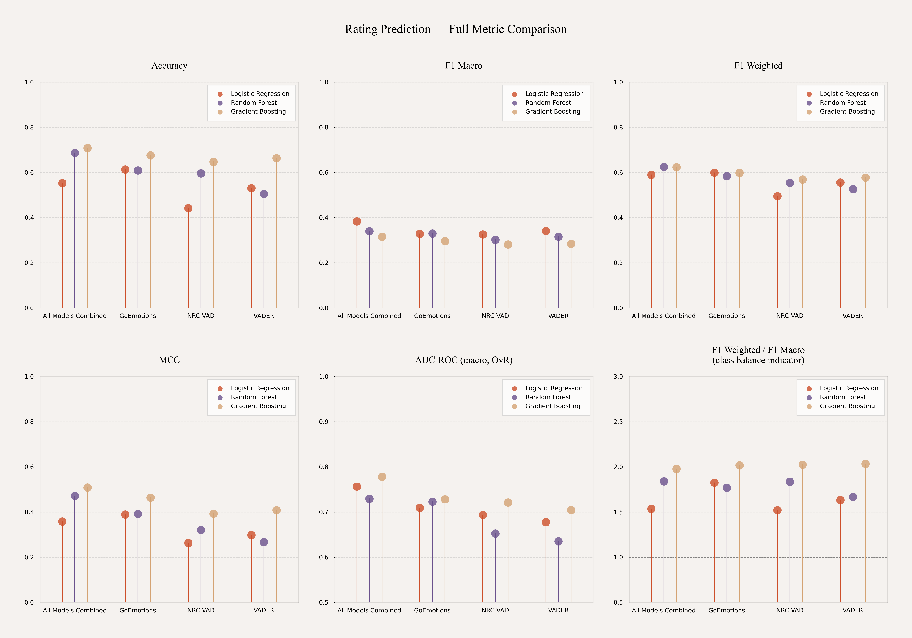
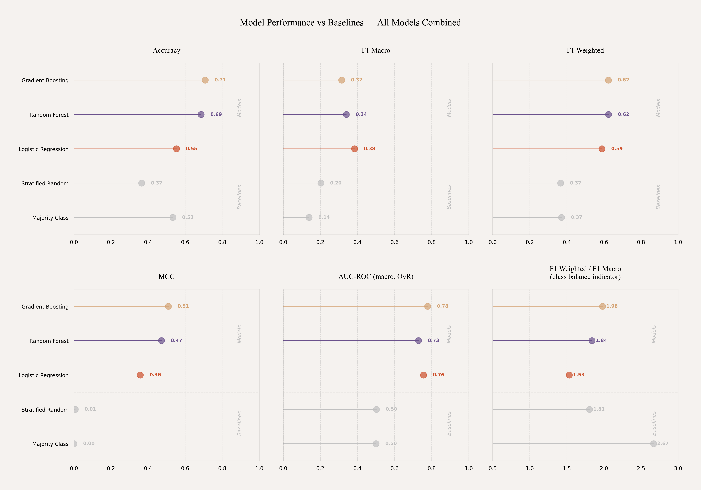
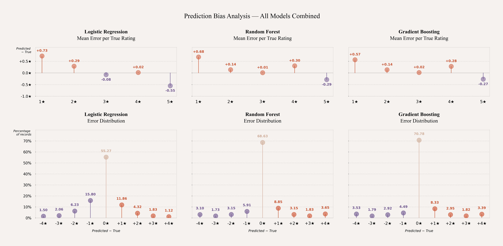
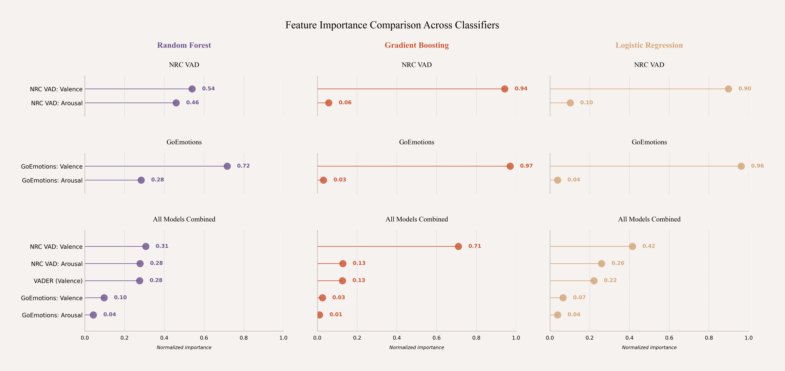

### Inter-model agreement *(methodological finding)*

Because the project triangulates across VADER, NRC VAD, and GoEmotions, their mutual agreement was tested directly:

| Pair | Pearson r (valence) | Cohen's κ |
|---|---|---|
| VADER – NRC VAD | 0.473 | 0.241 |
| VADER – GoEmotions | 0.561 | 0.378 |
| NRC VAD – GoEmotions | 0.435 | 0.148 |

Agreement is fair-to-moderate — never strong. This is the empirical justification for reporting all three models throughout rather than collapsing to one: conclusions that hold across all three (like the existence of category differences in Finding 1) are considerably more trustworthy than any single-model result.

---

## Data

### Sources

| Source | Method | Collected (raw) | After cleaning | Notes |
|---|---|---|---|---|
| Reddit (posts + comments) | PullPush API, 14 subreddits | 128,303 (1,430 posts + 126,873 comments) | 106,661 | Nov 2022 – present; posts and comments scraped separately |
| Google Play | `google_play_scraper`, dual sort (newest / most relevant) | 55,251 | 29,909 | 16 apps, English/US store |
| Apple App Store | iTunes RSS feed, dual sort (recent / helpful) | 10,485 | 3,564 | Language-filtered via `langdetect` |
| **Total** | | **194,039** | **140,134** | |

Cleaning and deduplication (Section 2) reduced the raw collection to **140,134 final records**. Google Play and App Store reviews (33,473 records) are the only records with star ratings.

### Final dataset composition

**By category**

| Category | Records |
|---|---|
| General | 97,855 |
| Therapeutic | 17,113 |
| Virtual Assistant | 14,625 |
| Educational | 10,541 |

**By application** (top entries)

| App | Category | Records |
|---|---|---|
| ChatGPT | General | 76,500 |
| Replika | Therapeutic | 15,373 |
| Claude | General | 11,314 |
| Amazon Alexa | Virtual Assistant | 4,194 |
| Question.AI | Educational | 3,430 |
| Nerd AI | Educational | 3,414 |
| Microsoft Copilot | Virtual Assistant | 3,351 |
| StudyX | Educational | 3,158 |
| Grok | General | 2,720 |
| Google Gemini | General | 2,685 |

*16 applications in total across 4 categories — see notebook Section 1 for the complete list.*

---

## Methodology

| Step | Stage | Description |
|---|---|---|
| 0 | Install & Import | Dependencies and library imports |
| 1 | Data Collection | Google Play, App Store, and Reddit scraping |
| 2 | Cleaning & Preprocessing | Deduplication, filtering, text normalisation (dual pipelines for lemmatised vs. raw text) |
| 3 | Exploratory Data Analysis | Distribution, temporal, and length analysis; word clouds |
| 4 | Sentiment & Arousal Analysis | VADER, NRC VAD, GoEmotions scoring |
| 5 | Inter-Model Agreement | Pearson/Spearman correlation, Cohen's κ, Bland–Altman |
| 6 | Inter-Category Differences | Kruskal-Wallis, Dunn post-hoc, effect sizes; within-source robustness check (6.4) |
| 7 | Timeline of Affect | Trend analysis with Spearman correlation, by category; per-app and fixed-effects robustness check (7.1.5) |
| 8 | Russell's Circumplex Model | Valence-arousal mapping, MANOVA validation |
| 9 | Topic-Affect Relationship Patterns | BERTopic modelling, quadrant-level keyword/n-gram extraction |
| 10 | Star Rating Prediction | Multi-model ML classification, bias analysis, baseline comparison, cross-validation and TF-IDF text baseline (10.5) |

## Tech Stack

- **Scraping:** `google_play_scraper`, `requests`, `langdetect`
- **Cleaning:** `clean-text`, `contractions`, `unidecode`, `nltk`
- **EDA & Visualisation:** `matplotlib`, `seaborn`, `wordcloud`
- **Sentiment & Emotion:** `vaderSentiment`, `transformers`, `torch`, NRC-VAD Lexicon v2.1
- **Statistics:** `scipy`, `scikit-learn`, `scikit_posthocs`, `statsmodels` 
- **Topic Modelling:** `bertopic`
- **Machine Learning:** `scikit-learn` (Logistic Regression, Random Forest, Gradient Boosting)

---

## Repository Structure


```
.
├── README.md
├── .gitignore
├── LICENSE
├── requirements.txt
├── notebook/
│   └── From_Distance_to_Trust.ipynb
├── data/
│   ├── raw/              
│   └── processed/        
├── assets/
└── presentation/
    └── Od_dystansu_po_zaufanie.pdf
```

**Note on data:** raw scraped reviews and Reddit content are not included in this repository, both for size reasons and because redistributing scraped platform content may conflict with the terms of service of Reddit, Google Play, and the App Store. The notebook is structured so that Section 1 (scraping) only needs to run once — from Section 2 onward, it reads from local CSV checkpoints.

## Getting Started

```bash
git clone https://github.com/kingakopczyk/chatbots-sentiment-analysis.git
cd chatbots-sentiment-analysis
pip install -r requirements.txt
```

1. **NRC-VAD lexicon (needed from Section 4.2).** It is not redistributed in this repository. Download *NRC-VAD-Lexicon-v2.1.txt* from the [official NRC page](http://saifmohammad.com/WebPages/nrc-vad.html) (free for non-commercial research and educational use) and place it in `data/raw/`.
2. **Open the notebook** and run the cells in order. The `data/raw/` and `data/processed/` folders are created automatically. The loading cell (Section 0.2) skips checkpoints that do not exist yet; each one is written by the section that produces it:

| Checkpoint | Written in |
|---|---|
| `raw/google_reviews.csv`, `raw/apple_reviews.csv` | Sections 1.1, 1.2 |
| `raw/reddit_posts.csv`, `raw/reddit_comments.csv` | Sections 1.3, 1.4 |
| `raw/opinions_raw.csv` | Section 2.1 |
| `processed/opinions_clean.csv` | Section 2.9 |
| `processed/opinions_emotion.csv` | Section 4.4 (re-saved in 8.3) |
| `processed/opinions_bertopic.csv` | Section 9.1 |
| `processed/opinions_keywords.csv`, `processed/opinions_ngrams.csv` | Sections 9.3, 9.4 |
| `processed/opinions_prediction.csv` | Section 10.1 |

Section 1 depends on three external, unauthenticated APIs (Google Play, Apple RSS, PullPush) whose availability and rate limits are outside this project's control. The exact 140,134-record dataset cannot be regenerated: newest-sorted reviews and Reddit availability change over time, so a fresh run gives similar but not identical numbers. GoEmotions and BERTopic steps benefit from GPU acceleration (CUDA); both fall back to CPU automatically but will run considerably slower.

---

## Limitations

- **Category is confounded with data source.** Educational chatbots are represented only by app reviews (10,541 of 10,541 records), whereas about 84% of Therapeutic and 86% of General records and about 53% of Virtual Assistant records come from Reddit. The pooled category differences in Section 6 therefore partly reflect differences between genres (app review vs. forum discussion), not only between chatbot types. Section 6.4 repeats the tests within each source: category differences remain significant, but effect sizes shrink by about 35–75% and the ordering of category pairs is no longer consistent across models.
- **Language and platform bias.** The dataset is limited to English-language content from Reddit, Google Play, and the App Store. Users who write public reviews or post in AI-related subreddits are not representative of the general chatbot user population.
- **Keyword-based filtering.** Technical review filtering (Section 2.5) uses keyword matching without contextual disambiguation, which risks removing genuine negative reviews that happen to mention technical vocabulary.
- **Interpolated affect coordinates.** Mapping GoEmotions categories onto Russell's circumplex (Section 4.3) involves interpolation for emotions without established psycholinguistic norms; these should be read as informed estimates, not validated values.
- **Moderate inter-model agreement.** VADER, NRC VAD, and GoEmotions agree only moderately with one another (Section 5). Findings that depend on a single model should be treated cautiously — convergence across all three is the stronger signal.
- **Temporal confounds.** Sentiment trends over time (Section 7) may partly reflect shifts in dataset composition — new apps entering the market, changes in platform activity — or the dual-sort sampling of app reviews (newest plus most relevant) rather than genuine change in user affect, and should not be read as causal evidence of improving or worsening chatbot quality.
- **Multiple comparisons in trend tests.** The category-level trend tests (Section 7.1.4) are 12 separate Spearman tests reported with uncorrected p-values in the notebook, and monthly means are autocorrelated. After Holm correction only the two Educational declines remain significant, and Section 7.1.5 shows that even these depend on the model and on the app; the other trends are exploratory.
- **Scope of the rating-prediction models.** The classifiers in Section 10.1 use only five sentiment and arousal scores, a single train/test split and default hyperparameters (no tuning). A TF-IDF text baseline with cross-validation (Section 10.5) outperforms them, so these results understate what review text can predict.

## Acknowledgments

Topic cluster labels generated by BERTopic (Section 9.2) were drafted with the assistance of Claude (Anthropic) and manually reviewed and verified by the author before inclusion.

---

## Author

**Kinga Kopczyk**
Capstone project, Postgraduate Diploma in Data Science

## License

*MIT Licence*
